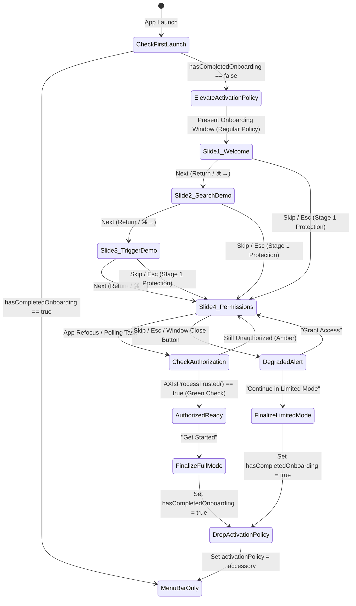

# Kibo First-Launch Onboarding (`OnboardingWindow`)

*   **Author:** Ayaansh
*   **Status:** Proposed
*   **Date:** 2026-11-06

--------------------------------------------------------------------------------

## Overview

Kibo is a keyboard-first macOS utility for clipboard history, prompt management, and universal text insertion. It primarily lives as an `LSUIElement` menu bar accessory. This design defines a dedicated, standalone first-launch onboarding window (`OnboardingWindow`) that guides new users through Kibo's core keyboard workflows—Universal Search (`⌘⇧K`) and Zero-Click Trigger Expansion (`:alias:`)—using interactive sandboxed previews, and handles the prerequisite macOS Accessibility (`AXIsProcessTrusted`) permission check before Kibo settles into its background menu bar role.

## The Problem

1. **Invisible Capabilities:** Because Kibo operates primarily in the background via the menu bar and global hotkeys, a first-time user who launches the app sees only a menu bar icon. Without proactive guidance, they do not discover the floating search panel (`⌘⇧K`) or trigger expansions (`:alias:`).
2. **Silent Failure Without Permissions:** Kibo relies on an active Event Tap (`CGEvent.tapCreate`) and synthetic keystrokes (`CGEventPost`) to replace trigger aliases into active external applications. If Accessibility permission is not granted, triggers fail silently, creating the perception that the app is broken.
3. **Menu Bar Utility Focus Glitches:** Launching a standard modal or sheet over a menu bar app can cause focus loss, window ordering bugs behind full-screen applications, or unexpected Dock behavior if application activation policy is not managed explicitly.

## Goals

*   Provide a standalone, beautifully framed native macOS window (680×460 pt) displayed strictly upon the user's first launch of Kibo (`hasCompletedOnboarding == false`).
*   Showcase Kibo's core features via interactive sandboxed SwiftUI components (search filter preview and inline trigger expansion simulator) completely isolated from production event taps.
*   Enforce a resilient 2-stage skip protection mechanism:
    *   Skipping from Slides 1–3 routes directly to the Accessibility permission gate (Slide 4).
    *   Skipping or closing from Slide 4 without granting permission presents an explicit degraded-state confirmation alert before allowing exit.
*   Implement real-time Accessibility permission detection with dual triggers (0.5s polling loop and `NSApplication.didBecomeActiveNotification`), displaying a transient 300ms verification loader upon refocus.
*   Maintain a degraded-state indicator in the Menu Bar dropdown (`⚠️ Accessibility: Not Granted`) when operating in Limited Mode.
*   Support secondary re-opening of the onboarding window from the Menu Bar menu and Help menu (**Help → Welcome to Kibo**).

## Non-Goals

*   Forcing application termination if permissions are refused (respects user agency and Apple HIG principle of Agency).
*   Embedding raster screenshot assets or heavy video walkthroughs (all UI is 100% vector SF Symbols and reactive SwiftUI views).
*   Introducing network requests or telemetry (Kibo remains strictly local, private, and offline).

## Critical User Journeys (CUJs)

### CUJ 1: First Launch Happy Path (Full Authorization)
*   **Given**: Kibo is launched for the first time on a Mac (`hasCompletedOnboarding == false`).
*   **When**: Kibo opens.
*   **Then**: Kibo sets `activationPolicy` to `.regular`, centers the 680×460 pt Onboarding window as key window, lets the user interact with the search and trigger previews, directs them to System Settings to grant Accessibility access, verifies access with a transient loader upon app refocus, marks `hasCompletedOnboarding = true`, smoothly fades out the window, switches `activationPolicy` to `.accessory`, and leaves Kibo running in the menu bar.

### CUJ 2: Early Skip with Degraded Mode Acknowledgment
*   **Given**: A user launches Kibo for the first time and immediately hits `Escape` or clicks `Skip` on Slide 1.
*   **When**: The user attempts early dismissal.
*   **Then**: The window does not close; it transitions immediately to Slide 4 (Permissions). If the user clicks `Skip` or the red window close button on Slide 4 without authorizing, a confirmation alert appears explaining that triggers will not work. When the user confirms "Continue in Limited Mode", onboarding marks complete, Kibo transitions to `.accessory` mode, and the Menu Bar menu displays an amber warning item for unauthorized Accessibility.

### CUJ 3: Subsequent Launch Normal Operation
*   **Given**: Kibo was previously onboarded (`hasCompletedOnboarding == true`).
*   **When**: Kibo launches normally or at system startup.
*   **Then**: The onboarding window does not display. Kibo immediately initializes in `.accessory` mode in the menu bar with background event taps active.

--------------------------------------------------------------------------------

## Technical Plan (Architecture)

### 1. Architectural Diagram & State Machine

### 2. Component Structure

1. **`OnboardingWindowController` (`NSWindowController`)**:
   * Creates a borderless or titled `NSWindow` with `.fullSizeContentView`, centered on `NSScreen.main`.
   * Sets `window.isMovableByWindowBackground = true` and `window.titleVisibility = .hidden`.
   * Manages `NSApp.setActivationPolicy(.regular)` on display, and fades out before transitioning back to `.accessory`.
   * Intercepts `windowShouldClose(_:)` to hook the red traffic light into Stage 2 skip protection.

2. **`OnboardingViewModel` (`@Observable`)**:
   * Tracks `currentStep: OnboardingStep` (enum: `welcome`, `searchDemo`, `expansionDemo`, `permissionGate`).
   * Manages `isVerifyingPermission: Bool`, `isAuthorized: Bool`, and `showDegradedAlert: Bool`.
   * Coordinates Combine / structured concurrency polling tasks and listens to `NSApplication.didBecomeActiveNotification`.

3. **Sandboxed Interactive Previews**:
   * `MockSearchSimulatorView`: Interactive search input with mock snippets (`:pr:`, `:email:`), live filtering, and Return-key insert simulation.
   * `MockExpansionSimulatorView`: Interactive text editor simulation where typing `:zoom:` expands into a meeting link with haptic feedback.
   * Both views operate purely within local `@State`, completely isolated from production databases or `GlobalTriggerEngine`.

4. **`PermissionService` & Menu Bar Integration**:
   * Wraps `AXIsProcessTrusted()` and `AXIsProcessTrustedWithOptions`.
   * Integrates a warning row in `MenuBarMenu`: `⚠️ Accessibility: Not Granted (Triggers Inactive)` if unauthorized.

--------------------------------------------------------------------------------

## Alternatives Considered

### Alternative A: Attached Sheet on Main Window
*   **Pros**: Reuses existing SwiftUI `Window("Kibo", id: "main")` scene.
*   **Cons**: Forces the full library window open on first launch, cluttering the desktop for an app meant to be a menu bar utility.
*   **Reason for Rejection**: Rejected by author. Kibo is primarily a menu bar accessory; onboarding should feel like a focused, lightweight welcome card rather than opening an entire library database.

### Alternative B: Hard App Termination if Permission Denied
*   **Pros**: Prevents users from running Kibo in an incomplete state.
*   **Cons**: Hostile UX. Violates Apple HIG Agency principles.
*   **Reason for Rejection**: Rejected by author. Users who only want manual clipboard history or emoji lookup should be allowed to use Kibo in Limited Mode with a clear warning.

--------------------------------------------------------------------------------

## Non-Functional Requirements

*   **Security & Privacy:** Kibo runs 100% offline. No analytics, tracking, or network calls.
*   **Performance & Ergonomics:** Fixed window size (680×460 pt), no resize jitter, zero App Nap latency via `didBecomeActiveNotification`.
*   **System Compatibility:** Designed for macOS 15 Sequoia, macOS 16 Tahoe, and macOS 17 Golden Gate with proper Liquid Glass vibrancy.

--------------------------------------------------------------------------------

## Detailed Implementation Plan

### Target Files to Create/Modify

#### 1. `Kibo/Sources/Kibo/UI/Onboarding/OnboardingWindowController.swift` (Create)
*   **Scope**: AppKit Window Management & Lifecycle
*   **Proposed Implementation**:
    *   Defines `OnboardingWindowController: NSWindowController, NSWindowDelegate`.
    *   Instantiates a 680×460 pt window with `NSVisualEffectView` backing.
    *   Applies activation policy morphing (`.regular` at start, `.accessory` upon close).
    *   Exposes `static let shared = OnboardingWindowController()`.

#### 2. `Kibo/Sources/Kibo/UI/Onboarding/OnboardingViewModel.swift` (Create)
*   **Scope**: State Machine & Permission Service
*   **Proposed Implementation**:
    *   Step navigation (Welcome → Search → Trigger → Permissions).
    *   2-stage skip logic: early skip routes to step 4; step 4 skip triggers `showDegradedAlert`.
    *   Dual-trigger permission detection with 300ms verification delay simulation.

#### 3. `Kibo/Sources/Kibo/UI/Onboarding/OnboardingView.swift` (Create)
*   **Scope**: SwiftUI Presentation & Slides
*   **Proposed Implementation**:
    *   Window titlebar with traffic light close hook.
    *   Slide 1: Welcome overview with 3 capability pills.
    *   Slide 2: `MockSearchSimulatorView`.
    *   Slide 3: `MockExpansionSimulatorView`.
    *   Slide 4: Accessibility permission gate with live badge, loader spinner, and "Authorize Now" button.
    *   Footer navigation with animated step pills, Back, and Continue/Get Started buttons.
    *   Degraded state confirmation sheet.

#### 4. `Kibo/Sources/Kibo/App.swift` (Modify)
*   **Scope**: Application Startup Hook & Menu Bar Integration
*   **Proposed Implementation**:
    *   In `AppDelegate.applicationDidFinishLaunching`, check `@AppStorage("hasCompletedOnboarding")`. If false, invoke `OnboardingWindowController.shared.show()`.
    *   In `MenuBarMenu`, add "Welcome to Kibo…" under Settings, and display `⚠️ Accessibility: Not Granted` warning when unauthorized.

### Verification Plan

*   **Build Verification**: Package builds with zero errors or warnings via `swift build`.
*   **First Launch Test**: Clear `hasCompletedOnboarding` in UserDefaults, launch app, verify window opens centered with `.regular` activation policy.
*   **Keyboard Navigation Test**: Test `Return`, `Esc`, `⌘→`, `⌘←`, and `Tab`. Verify early `Esc` jumps to Slide 4.
*   **Permission Gate Test**: Test closing from Slide 4 without permission; verify degraded warning alert triggers.
*   **Re-open Test**: Click **Help → Welcome to Kibo** or Menu Bar item and verify onboarding can be reviewed anytime.

--------------------------------------------------------------------------------

*Drafted with EGM*
