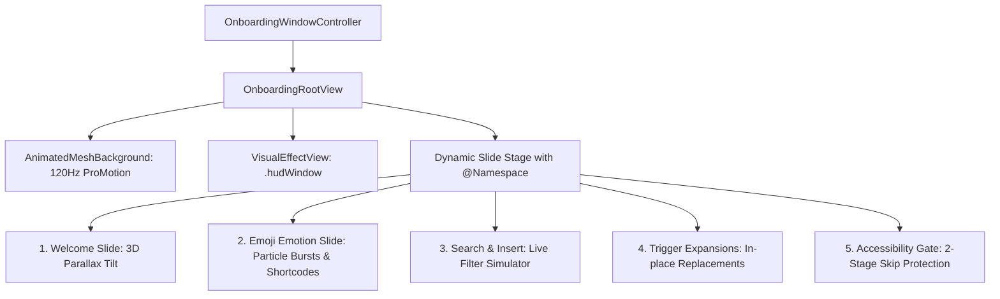

# Kibo First-Launch Motion Onboarding & Instant Emoji Engine

*   **Author:** Ayaansh
*   **Status:** Approved
*   **Date:** 2026-11-06

--------------------------------------------------------------------------------

## Overview

Kibo is a keyboard-first macOS utility for clipboard history, prompt management, universal text insertion, and instant emoji lookup. It primarily lives as an `LSUIElement` menu bar accessory. This design defines a dedicated, standalone first-launch onboarding window (`OnboardingWindow`) engineered according to Apple Design Award standards (`macos-motion-onboarding`), featuring:
1. 120Hz ambient living background with a harmonic `MeshGradient`.
2. 3D cursor-reactive parallax physics with liquid glass specular border highlights.
3. A dedicated interactive Emoji Emotion Graphics showcase with GPU-accelerated particle burst emitters.
4. Universal floating search (`⌘⇧K`) and in-place trigger expansion (`:alias:`) simulators.
5. Strict 2-stage skip protection routing to the macOS Accessibility (`AXIsProcessTrusted`) permission check.

## The Problem

1. **Hidden Capabilities:** Because Kibo operates primarily in the background via the menu bar and global hotkeys, first-time users often fail to discover its universal emoji engine (1,723+ emojis with natural search and shortcodes) and floating search panel (`⌘⇧K`).
2. **Silent Failure Without Permissions:** Kibo relies on an active Event Tap (`CGEvent.tapCreate`) and synthetic keystrokes (`CGEventPost`) to replace trigger aliases and emojis into active external applications. If Accessibility permission is not granted, triggers fail silently.
3. **Desktop Ergonomics Mismatch:** Static, flat mobile onboarding ports feel foreign and cheap on macOS displays. An Apple Design Award-level experience requires native AppKit translucency, ProMotion refresh rates, pointer reactivity, and keyboard-first navigation.

## Goals

*   Provide a standalone, frameless native macOS window (700×490 pt) displayed strictly upon the user's first launch of Kibo (`hasCompletedOnboarding == false`).
*   Incorporate a 120Hz ProMotion living `MeshGradient` background with Display P3 wide-gamut colors and an accessible fallback for reduced motion.
*   Feature 3D continuous-hover parallax tilting on hero cards (clamped strictly to $\le 6^\circ$) with liquid glass specular edge reflections.
*   Deliver a dedicated **Instant Emoji & Emotion Graphics** interactive slide with real-time shortcode substitution (`:fire:` -> 🔥, `:party:` -> 🎉, `:rocket:` -> 🚀, `:salute:` -> 🫡) and GPU-accelerated particle burst emitters.
*   Enforce a resilient 2-stage skip protection mechanism:
    *   Skipping from Slides 1–4 routes directly to the Accessibility permission gate (Slide 5).
    *   Skipping or closing from Slide 5 without granting permission presents an explicit degraded-state confirmation alert before allowing exit into Limited Mode.
*   Maintain a degraded-state indicator in the Menu Bar dropdown (`⚠️ Accessibility: Not Granted`) when operating in Limited Mode.
*   Support secondary re-opening of the onboarding window from the Menu Bar menu and Help menu (**Help → Welcome to Kibo**).

## Non-Goals

*   Forcing application termination if permissions are refused (respects user agency).
*   Embedding raster screenshot assets or heavy video walkthroughs (all visuals are vector SF Symbols, live SwiftUI views, and Canvas particle emitters).
*   Introducing network requests or telemetry (Kibo remains strictly local, private, and offline).

## Critical User Journeys (CUJs)

### CUJ 1: First Launch Happy Path (Full Authorization & Emoji Exploration)
*   **Given**: Kibo is launched for the first time on a Mac (`hasCompletedOnboarding == false`).
*   **When**: Kibo opens.
*   **Then**: Kibo sets `activationPolicy` to `.regular`, centers the 700×490 pt Onboarding window as key window, lets the user interact with the 3D parallax cards, test emoji emotion particle bursts, test search and trigger previews, directs them to System Settings to grant Accessibility access, verifies access with a transient loader upon app refocus, marks `hasCompletedOnboarding = true`, smoothly fades out the window, switches `activationPolicy` to `.accessory`, and leaves Kibo running in the menu bar.

### CUJ 2: Early Skip with Degraded Mode Acknowledgment
*   **Given**: A user launches Kibo for the first time and immediately hits `Escape` or clicks `Skip` on Slide 1 or 2.
*   **When**: The user attempts early dismissal.
*   **Then**: The window does not close; it transitions immediately to Slide 5 (Permissions Gate). If the user clicks `Skip` or the red window close button on Slide 5 without authorizing, a confirmation alert appears explaining that triggers and auto-insert will not work. When the user confirms "Continue in Limited Mode", onboarding marks complete, Kibo transitions to `.accessory` mode, and the Menu Bar menu displays an amber warning item for unauthorized Accessibility.

--------------------------------------------------------------------------------

## Technical Plan (Architecture)

### 1. Motion Architecture & Component Mapping

### 2. Component Structure

1. **`AnimatedMeshBackground`**:
   - 3x3 harmonic animated `MeshGradient` running at 120Hz via `TimelineView(.animation)` with Display P3 wide-gamut colors.
   - Respects `accessibilityReduceMotion` with a calm, static liquid glass gradient fallback.

2. **`HoverParallaxModifier`**:
   - Calculates normalized continuous hover position via `.onContinuousHover`.
   - Applies `.rotation3DEffect` pitch/roll clamped strictly to $\le 6^\circ$.
   - Paints a specular liquid glass edge highlight using an angular/radial gradient.

3. **`EmojiParticleBurstEmitter`**:
   - GPU-accelerated `Canvas` particle emitter that triggers celebratory emotion bursts, glowing sparks, and floating reaction physics whenever an emoji or shortcode is typed or clicked.

4. **`OnboardingViewModel` (`@Observable`)**:
   - 5 steps: `welcome`, `emojiMotion`, `searchDemo`, `expansionDemo`, `permissions`.
   - Stage 1 skip: steps 0..3 route to step 4 (`permissions`).
   - Stage 2 skip: step 4 triggers `showDegradedAlert` if unauthorized.

5. **`OnboardingWindowController` (`NSWindowController`)**:
   - 700×490 pt transparent borderless window centered on `NSScreen.main`.
   - Manages activation policy morphing (`.regular` → `.accessory`).

--------------------------------------------------------------------------------

## Detailed Implementation Plan

### Target Files Created/Modified

1. `Kibo/Sources/Kibo/UI/Onboarding/Motion/OnboardingMotionTokens.swift` (Created):
   - Mandated spring physics curves (`.spatialMorph`, `.tactileSnappy`, `.cursorFollow`, `.keypressDown`).
   - `VisualEffectView` AppKit bridge.
   - `HoverParallaxModifier` for 3D continuous-hover tilt.
2. `Kibo/Sources/Kibo/UI/Onboarding/Motion/AnimatedMeshBackground.swift` (Created):
   - 120Hz ProMotion 3x3 `MeshGradient` with harmonic sinusoidal displacement.
3. `Kibo/Sources/Kibo/UI/Onboarding/Motion/EmojiParticleBurstEmitter.swift` (Created):
   - GPU-accelerated particle emotion bursts with velocity, drag, and gravity.
4. `Kibo/Sources/Kibo/UI/Onboarding/OnboardingViewModel.swift` (Modified):
   - 5 steps with spatial morph transitions and 2-stage skip protection.
5. `Kibo/Sources/Kibo/UI/Onboarding/OnboardingView.swift` (Modified):
   - Full motion graphics integration, `EmojiMotionSlideView`, 3D parallax tilt, and matched-geometry indicators.
6. `Kibo/Sources/Kibo/UI/Onboarding/OnboardingWindowController.swift` (Modified):
   - 700×490 pt transparent window frame configuration.
7. `Kibo/Sources/Kibo/SelfTest.swift` (Modified):
   - 5-step onboarding state machine verification.
